# SWEN303 Project 3

[Live site](https://swen303-group-10.github.io/project-3/)

## Final diagrams

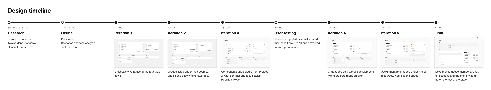
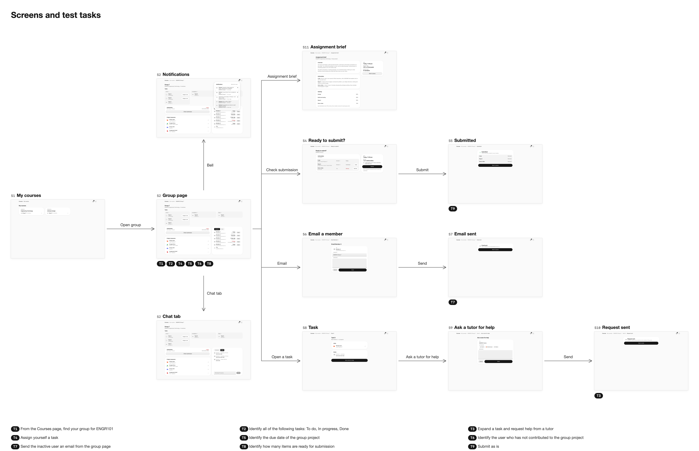

## Iteration history

- [Iteration 1 wireframes](./wireframes/iteration-1/index.html)
  - New group
    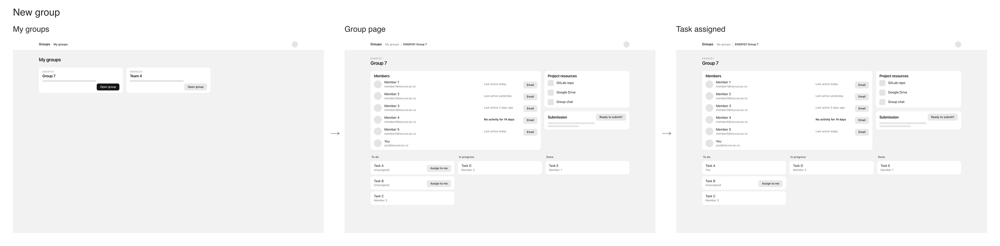
  - Contact member
    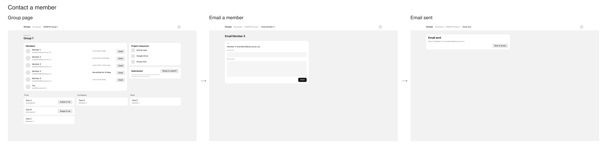
  - Submit
    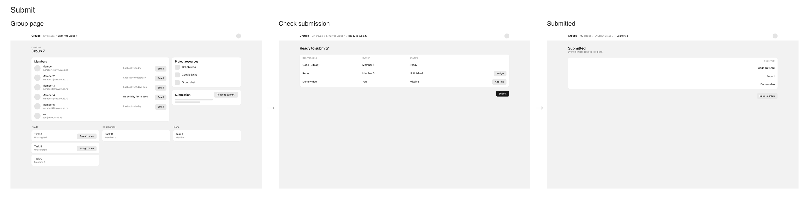
  - Get help
    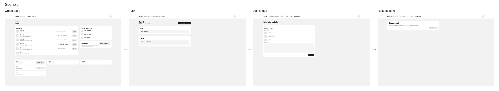
- [Iteration 2 wireframes](./wireframes/iteration-2/index.html)
  - [Changelog](./wireframes/iteration-2/CHANGES.md)
  - Changes:
    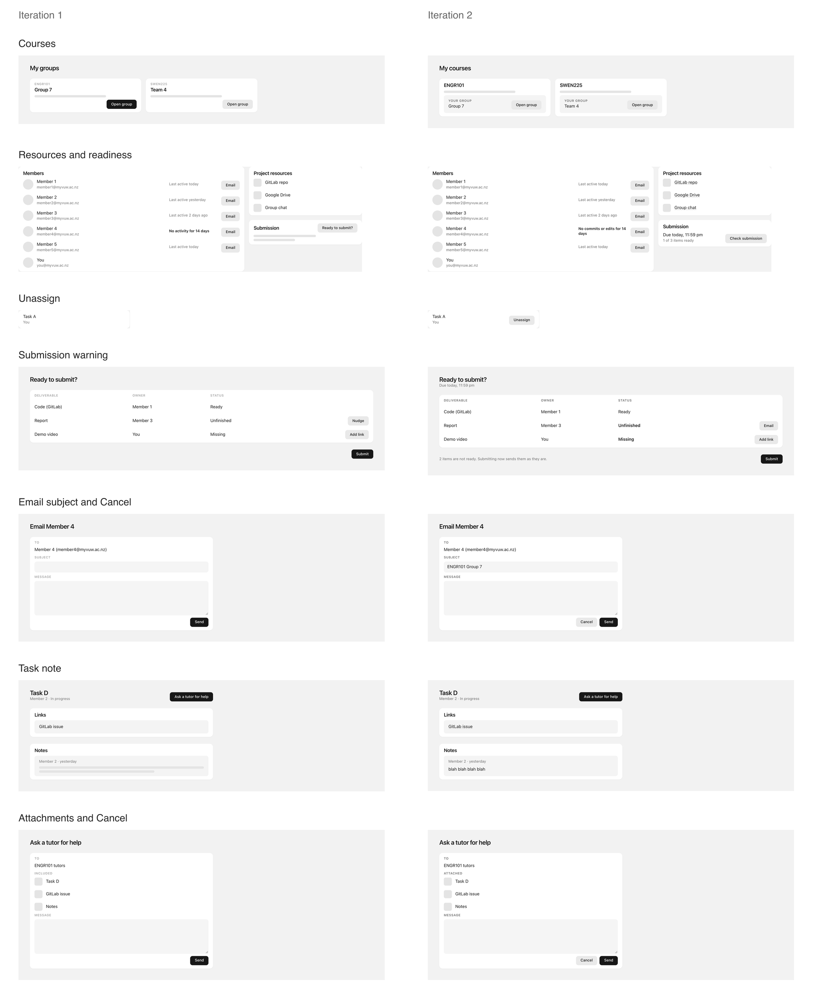
- [Iteration 3 wireframes](./wireframes/iteration-3/index.html)
  - [Changelog](./wireframes/iteration-3/CHANGES.md)
  - Changes:
    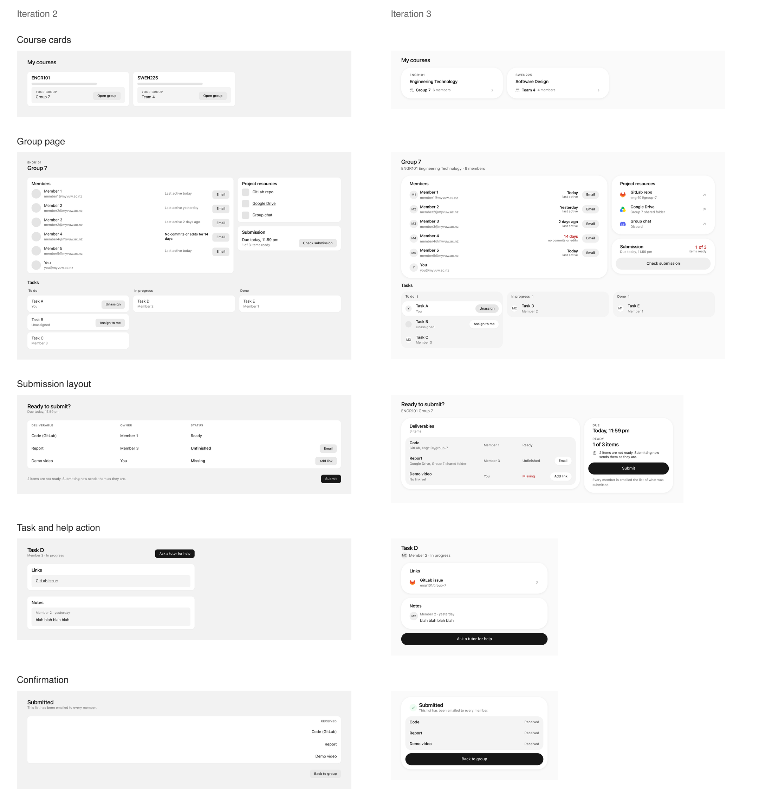
- Iteration 4
  - [Changelog](./wireframes/iteration-4/CHANGES.md)
  - Changes:
    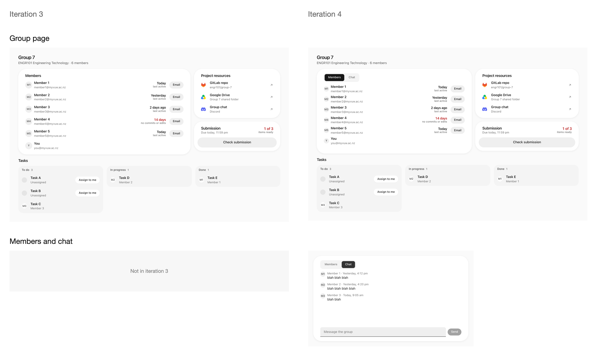
- Iteration 5
  - [Changelog](./wireframes/iteration-5/CHANGES.md)
  - Changes:
    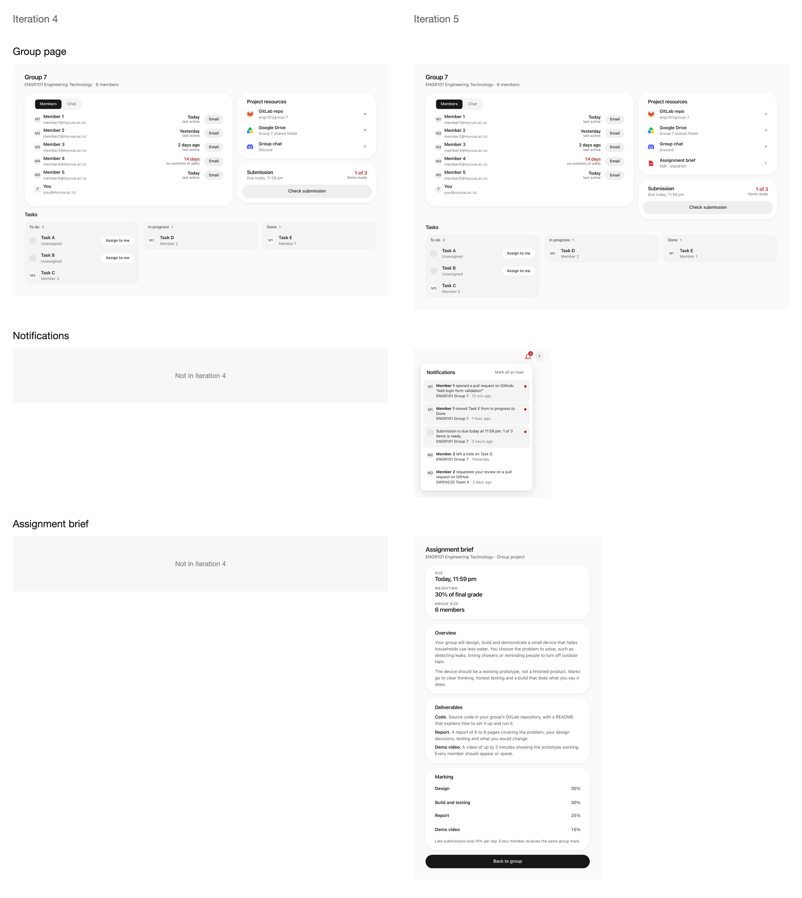
- [Final prototype](./final-prototype.html)
  - [Changelog](./wireframes/final/CHANGES.md)
  - Changes:
    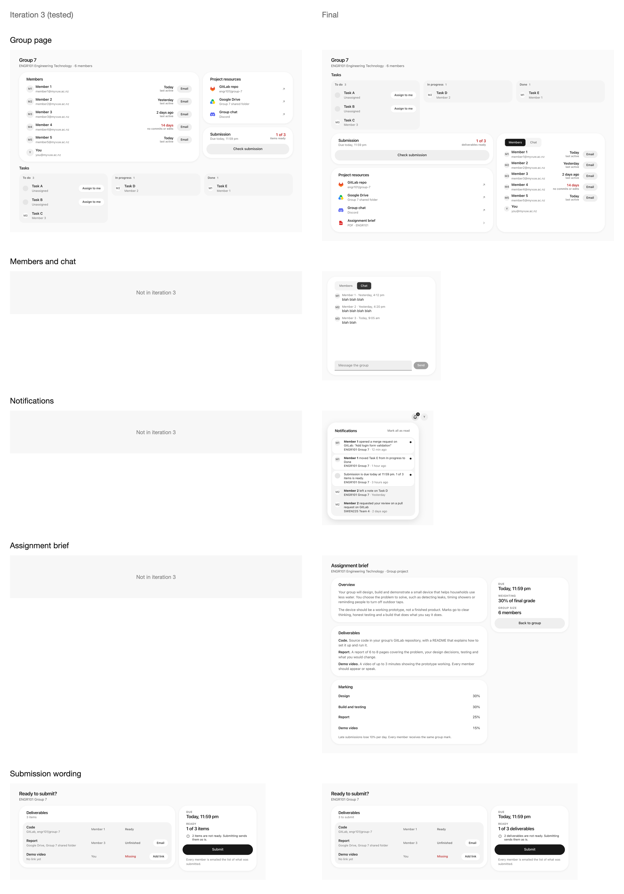
